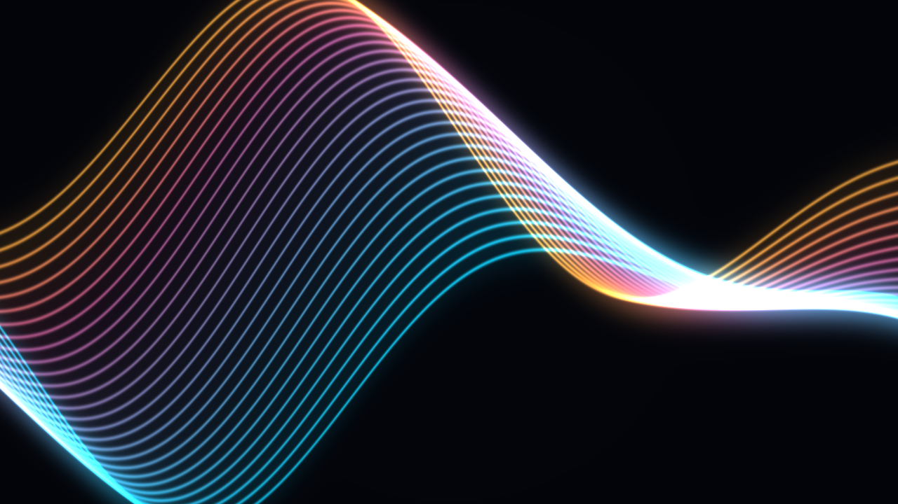
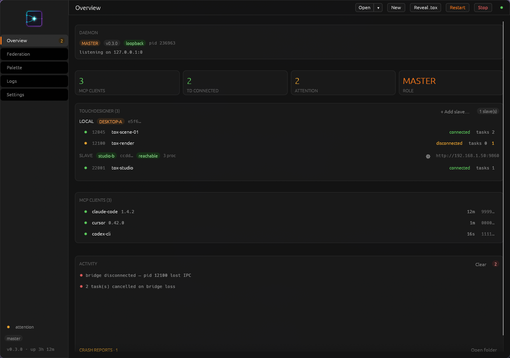

# td-mcp-rs

**Give your AI assistant a connection to TouchDesigner—and a whole task to do.**
Ask it to explore a network, build an effect, fix a shader, or show you what changed. It can read
and edit the actual project, capture its output, and work across several TD
instances or computers.

> “Build a feedback trails effect in a new COMP. Give me one slider for the
> trail length, then capture the output so we can see how it looks.”

You bring the visual idea. Once connected, the assistant can work through the
build → inspect → capture → revise loop on its own, within the scope you give
it. You don't have to dictate every node or parameter. You still get an ordinary
TD network to inspect, adjust, and make your own.

[Start here](docs/QUICKSTART.md) · [Things to try](docs/RECIPES.md) ·
[Download](https://github.com/Verbalize-public/td-mcp-rs/releases) ·
[Documentation map](docs/README.md)



*A GLSL TOP created in a scratch TD project through MCP, then captured from its
actual output. [More captures and a short recording](docs/SCREENSHOTS.md).*

## How it fits into your workflow

Three pieces connect your conversation to your project:

```text
Your assistant → td-mcp-rs on your computer → a bridge COMP inside TouchDesigner
```

**MCP** is the protocol your assistant uses to call tools. The **daemon** is
our small local application: it handles those calls and provides a tray
and dashboard. The **bridge** is the component you drop into a TD project
so the daemon can work with it. You don't need to write Python to use them.

One daemon can serve multiple assistants and TD processes. Each project is
addressed explicitly, so your experiment and your show file can stay separate.
The assistant should confirm which one you mean before editing.

## Get started

1. Install the release for your computer and launch td-mcp-rs.
2. Connect your MCP-compatible assistant. Claude Code has a bundled plugin;
   other clients use the installed executable with the `mcp` argument.
3. Open the dashboard, choose **Reveal .tox**, and drag `bootstrap.tox` into
   your TD project. Save the project with its bridge.
4. Ask: “List my TouchDesigner instances and inspect `/project1` in this project.”

The [quick start](docs/QUICKSTART.md) walks through each step, including what
success looks like. Windows and macOS have installers; Linux runs the daemon
natively and needs an existing [Wine/TouchDesigner setup](docs/LINUX_SUPPORT.md).
TouchDesigner itself is installed separately.

## What you can make it do

### Give it the whole task

> “Start a new project from my template. Build an audio-reactive visual in
> its own COMP, expose the controls, check for errors, and show me the output.
> Keep refining it until the result matches the brief.”

The tools cover the steps an autonomous assistant needs: launch TD, inspect
what's there, choose operators or Palette components, build, run code, and
check the result. The bundled operating skills guide that workflow. How well
it follows the brief depends on your assistant and the evidence it actually
checks; the finished look is still yours to judge.

### Get past “why is this black?”

Inspect operators, wiring, parameters, errors, shader code, and the nodes
selected in your editor. Capture intermediate outputs, read CHOP samples or
TOP pixel values or SOP point positions, and follow a signal until it stops
doing what you expected.
Live Python API help lets the assistant check the TD version you're running.

> “Trace this render chain. Show me where the image disappears and explain
> the fix before changing anything.”

### Give your Palette a second pair of eyes

Ask the assistant to explore your Palette, inspect a component's controls,
and reuse it in your network. Your own `.tox` collection can become part of
that working library too. No need to rebuild a perfectly good particle system
because nobody remembered which folder it was in.


*The real Palette dashboard rendered with example cards. The assistant can
build these descriptions from component probes. [Palette recipes](docs/RECIPES.md#teach-it-your-palette).*

For custom work, it can create operators, wire networks, edit expressions,
run Python, and build parameter pages. Export a control interface, register a
script for repeated runs, or compare fields against an earlier observation.

Edits run in order. If one fails, earlier changes may remain; the result tells
the assistant where to investigate. Save before experimenting, and give new
ideas their own COMP. A tidy sandbox beats a root network full of `null47`.

### Look at the right moment

A feedback effect needs time to develop. Timed capture can trigger its reset,
allow initialization and warmup, then advance **one frame at a time** and
capture chosen offsets. Intervening frames are processed too. Pair captures
with parameter/error inspection to check appearance and state together.

> “Reset this effect, warm it up for 10 frames, then show me offsets 0, 30,
> and 60. Leave the timeline paused when you're done.”

You can also record consecutive frames from a TOP. Timing jobs report status
and support cancellation; they reserve that TD instance while running.
Recording currently produces silent qtrle MOV files, with size and duration
bounds. See [timing recipes](docs/RECIPES.md#look-at-specific-frames) for
controls, limits, and the current platform acceptance scope.

### Keep several projects in view

List running instances, open a project in a new process, create one from a
starter template, and stop a specific instance. With
[federation](docs/FEDERATION.md), the same assistant can inspect and operate
TD on other computers through one coordinator.

> “Compare the output on studio-b with the rehearsal project on this computer.
> Tell me which project and machine each image came from.”

Federation routes calls; it does not synchronize playback, copy your media,
or provide automatic show-machine failover.

### Prepare files before opening TD

Unpack `.toe` and `.tox` files using Derivative's official tools, inspect or
edit the expanded files, check their structure, and repack them. Install or
update the bridge in a closed project, with a backup by default. This is
useful when a folder of older projects needs connecting to your assistant.

Offline checks cannot tell you whether a shader renders correctly. Open a
copy in TD for that final check. See [project and file recipes](docs/RECIPES.md#project-and-file-wrangling).

### When something goes sideways

Autonomous work needs a way to recover as well as a way to build.

| What happens | What helps you continue |
| --- | --- |
| The daemon stops or crashes | The standard MCP connection reconnects and can start the daemon again after sustained downtime. |
| A bridge disconnects or a call times out | The failure is reported; the assistant can inspect the affected state before deciding what to repeat. |
| A Palette probe hangs | The pending batch is recorded so a later scan can flag suspect components; repeated probe failures can automatically exclude an entry. |

Daemon/GUI panics produce crash reports with recent log context for investigation.
Failed tool calls aren't silently replayed: a lost reply doesn't prove an edit
never happened. That's especially useful when several assistants share TD.

Recovery restores communication, not unsaved project state. It doesn't undo
edits or resume jobs invalidated by bridge reload. See the
[recovery guide](docs/OBSERVABILITY.md#when-a-connection-drops) for the next steps.

## Dashboard, privacy, and control

<details>
<summary>See the fleet dashboard</summary>



*Dashboard preview with example fleet data. Hostnames, counts, and connection
states illustrate the UI; they are not a live studio deployment.*

</details>

The dashboard brings together instances, federation, Palette, logs, and
settings. Configuration and customized starter templates survive upgrades.
Most local use needs no network configuration.

The default listener is local-only. For federation, use trusted computers,
access keys, and a trusted LAN or VPN: remote tools can run Python and access
files. Plain HTTP does not encrypt traffic. The daemon has no hosted service;
anything returned to your assistant follows that assistant's data policies.

## For developers

Rust 1.92+; Python 3 and the test dependencies for bridge/guidance checks.

```sh
cargo build --workspace
scripts/check.sh
```

On Windows, use `scripts/check.ps1`. Start with [Development](docs/DEV_ENV.md),
[Architecture](ARCHITECTURE.md), and [Testing](docs/TESTING.md). The
[tool contract](docs/CONTRACT.md) holds exact request/result details;
[current limitations](docs/OPEN_WORK.md) separates shipped behavior from gaps.
