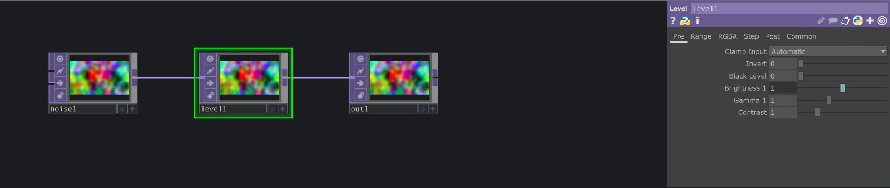

# Your first TouchDesigner conversation

Let's connect your assistant to a TD project, let it look around, and make one
small visual. Start with a scratch project so you can experiment comfortably.

You need **TouchDesigner already installed**, an **assistant with MCP tool
support**, and the td-mcp-rs release for your computer. No Rust build or Python
scripting is needed for this route. Linux users need a working
[Wine/TD setup](LINUX_SUPPORT.md) first.

## 1. Install and launch td-mcp-rs

Download from [Releases](https://github.com/Verbalize-public/td-mcp-rs/releases).

| Your computer | What to do |
| --- | --- |
| Windows | Run the x64 installer, then launch td-mcp-rs. Installation is per-user. |
| Mac with Apple Silicon | Open the ARM64 DMG, move the app to Applications, then open it. |
| Mac with Intel | Use the Intel DMG, move the app to Applications, then open it. |
| Linux | Extract the x86_64 archive and run the two commands below in its folder. |

```sh
./tdmcp-daemon install
./tdmcp-daemon ensure
```

For a portable Windows archive, run `.\tdmcp-daemon.exe install` and
`.\tdmcp-daemon.exe ensure` in PowerShell instead. `install` prints the
installed executable path; keep it for the next step. Packaged install paths
are listed in [Installation](INSTALL.md#connect-your-assistant).

**You should see:** a tray/menu-bar icon that opens the dashboard. It's fine
for the instance list to be empty at this point. If macOS blocks an unsigned
app, verify its source before allowing it in System Settings → Privacy &
Security. More platform details are in [Installation](INSTALL.md).

## 2. Connect your assistant

Choose one route; you don't need both.

**Claude Code:** follow the [plugin setup](CLAUDE_CODE_PLUGIN.md#installing).
It connects the server and includes instructions that help the assistant use
TouchDesigner tools. You'll supply the installed daemon's executable path.

**Other MCP clients:** add a local **stdio MCP server** in your assistant's
MCP settings. “Stdio” means the assistant launches a small process and talks
to it directly. Use these values:

| Setting | Value |
| --- | --- |
| Name | `touchdesigner` |
| Command | Absolute path to `tdmcp-daemon` (or `tdmcp-daemon.exe` on Windows) |
| Arguments | `mcp` — or `["mcp"]` if the setting expects a JSON array |

Use the executable file, not its containing folder. Clients with JSON settings
can adapt the [configuration example](INSTALL.md#connect-your-assistant).
The argument is `mcp`; `start` runs the daemon but doesn't speak the protocol
this connection needs.

Restart or reconnect the assistant's MCP connection after saving.

**You should see:** TouchDesigner tools available in the assistant. Ask:

> “Use the td-mcp-rs tools to list my TouchDesigner instances.”

An empty result is still a successful connection to the daemon. Next, connect
an actual project.

## 3. Add the bridge to your project

1. Open TouchDesigner and a scratch project.
2. Open the td-mcp-rs dashboard from its tray icon and choose **Reveal .tox**.
3. Drag the revealed `bootstrap.tox` into your TD network. It creates a
   component named `tdmcp_rs`.
4. Check the dashboard for your TD instance with a connected bridge, then
   save the project in TD so the bridge is there next time.

The bridge lets the assistant work inside this project. Add one to each
project you want to control. If you don't have a tray, find `bootstrap.tox`
in the [runtime data directory](INSTALL.md#add-the-bridge-to-a-project).

**You should see:** a connected TD process in the dashboard. A process that
is listed but disconnected still needs its bridge connection checked.

## 4. Let it look around

> “List my TouchDesigner instances. In the scratch project I just connected,
> inspect `/project1` and explain what's there. Don't change anything yet.”

If you have several projects open, name the scratch file and have the
assistant confirm the matching instance. It uses a **PID** (process ID) to
address that running TD; you don't have to memorize it.

Then try:

> “Find a TOP in that network, capture its output, and describe what you see.
> If there isn't a TOP yet, tell me.”

**You should get:** real operator names and, if a TOP exists, an image of its
output. A text claim that the capture succeeded is not the same as viewing it.
If the assistant can't access the returned image, have it say so.

## 5. Make something small

Save your scratch project, then ask:

> “In a new Base COMP under `/project1`, build a Noise TOP → Level TOP →
> Null TOP chain. Name the COMP `first_visual` and the output `out1`.
> Expose brightness on the COMP. Capture the output and check for errors.”

Open the new COMP in TD. You should be able to follow the wiring, adjust its
control, and see the result. If that name already exists, ask for a new name
rather than replacing your work.



*The same three-node chain in a scratch TD project, with coloured noise enabled.
The brightness parameter references the COMP's exposed control.*

Try a follow-up: “Make it softer and slower, then show me the difference.”
The assistant can edit the network; your eye still gets the final vote.
Save in TD when you're happy with it. Don't assume every scripted change can
be undone with Ctrl/Cmd+Z.

## If a step gets stuck

| What you see | First check |
| --- | --- |
| No TD tools in the assistant | Executable path, `mcp` argument, and the client's MCP connection log |
| Tools work, but no TD process appears | TD is open; on Linux, the configured Wine runner matches your installation |
| TD appears as disconnected | Bridge COMP is present; check the dashboard Logs and any blocking TD dialogs |
| A request times out | Inspect the existing process before repeating an edit or opening another copy |

After three identical failed attempts, collect the error and logs instead of
retrying the same thing. [Troubleshooting](OBSERVABILITY.md) explains recovery.

## Where to go next

- [Recipes](RECIPES.md): feedback effects, precise frame captures, reusable components, and debugging.
- [Federation](FEDERATION.md): work with TD on another computer.
- [Configuration](CONFIG.md): starter projects, your Palette, and settings.
- [Documentation map](README.md): technical references and developer guides.
