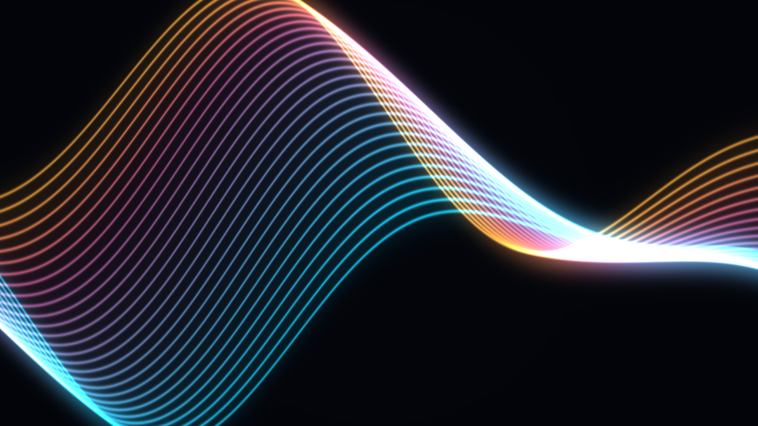
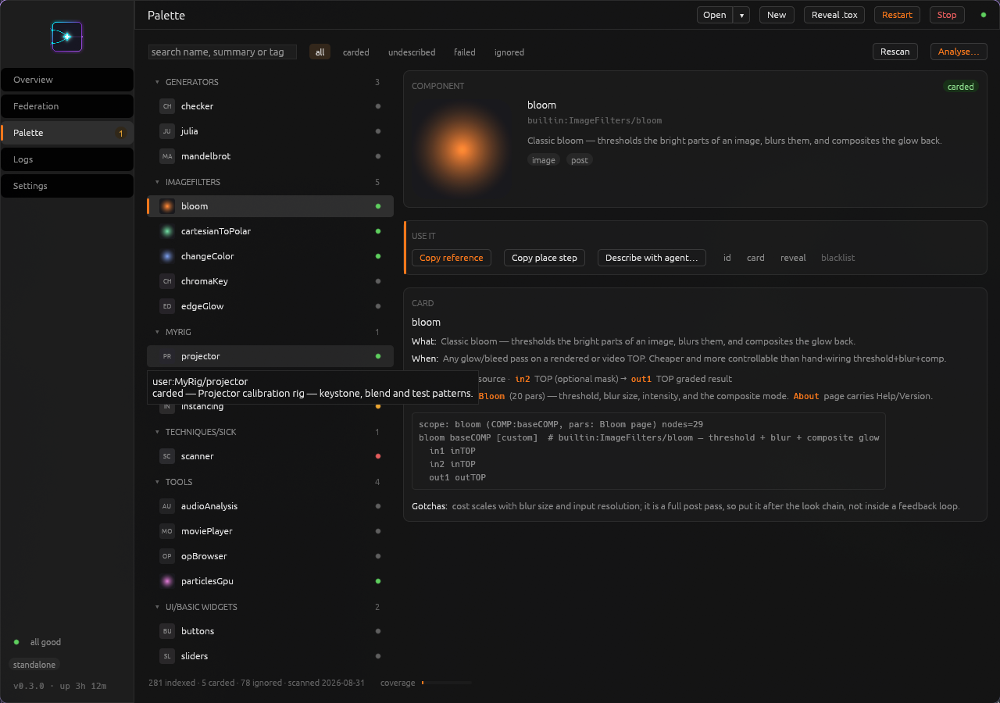

# Recipes — what to say

Describe the result you want in your own words. You don't need to remember
tool names. These prompts are starting points: replace example paths with
operators in your project, and tell the assistant which project to use.

New connection? Finish the [quick start](QUICKSTART.md) first.

Jump to [timing and recording](#look-at-specific-frames),
[Palette](#teach-it-your-palette), [debugging](#debugging),
[offline files](#project-and-file-wrangling), or [federation](#across-machines).

## Before you start

Give the assistant somewhere to work: “Build it in a new COMP called
`bloom_v2`” is easier to review than an open invitation to rearrange the root.
Save first, especially while trying unfamiliar workflows.

“This node” can be useful: the assistant can read editor panes and selections.
With multiple panes or instances, have it confirm the path and project before
editing. Ask it to capture results and inspect errors; a confident paragraph
isn't a render preview.

## Level 1 · Look and explain

Start with observation:

> “Walk me through this network. What's generating the image, what's modifying
> it, and where does it leave the COMP?”

> “Show me the parameters on the node I've selected. Which ones matter for
> the look, and which are just setup?”

> “Read this shader DAT and explain what each block does.”

> “Find the operators with errors or warnings and explain the messages.”

The assistant can read real names, wiring, values, and source text, then query
live TD Python API help. Inspection and capture can trigger cooking or shader
compilation; “look” doesn't mean TD stops evaluating the project.

## Level 2 · Small precise edits

> “Add a Level TOP after `noise1`, set gamma to 0.8, and connect it to `out1`.”

> “Give this COMP a `Look` page with gain, saturation, and blur controls.
> Connect them to the parameters inside and test each control.”

> “Duplicate this chain into three new COMPs, one per scene. Give each a
> different noise seed and lay them out clearly.”

> “Explain this wiring first, then rename the nodes and add useful comments.”

Edits run in an ordered batch. A hard failure stops the batch, but earlier
steps—and parts of the failing step—may already have changed the project.
Ask the assistant to inspect that state before repairing or repeating it.

## Level 3 · Delegate a chunk

> “Build an audio-reactive particle effect in a new COMP. Check the Palette
> for a suitable component before building from scratch.”

> “Make a feedback trails effect with one control for trail length. Add a
> reset pulse so we can compare changes from the same starting point.”

> “Port this Shadertoy into a GLSL TOP. Get it compiling, then capture the
> result: <paste shader>.”

> “Build a three-scene switcher with a crossfade and a preview for each scene.”

Tell it what a good result looks like: “soft trails, no abrupt jumps, readable
at a distance” is more useful than “make it better.” Finish with:

> “Capture the output, inspect errors, and tell me what you checked. If you
> can't see the image, say so.”

## Level 4 · End to end

> “Start a new TouchDesigner project from the configured template. Build a
> microphone-driven visual in its own COMP and show me the output.”

> “Open a copy of `show_v3.toe` in a new instance. Investigate the slow section
> and propose a fix before editing it.”

> “Build our output chain as a reusable COMP: colour correction, LUT, and
> safe-area overlay. Expose its controls, test them, and save a new `.tox`.”

New projects use the installed starter project unless you configure
`project.template_path`. A custom template should already contain the bridge;
see [Configuration](CONFIG.md#common-settings).

Component saves can return the actual file path and digest through
`project_snapshot`. Whole-project saves through that tool have a recorded risk of losing the
response while TD keeps running. Save the `.toe` from TD's UI for this workflow;
a lost tool reply does not mean no file was written. See [Current limitations](OPEN_WORK.md).

## Look at specific frames

For an evolving visual, a screenshot taken “soon” is not much of a test.
Timed capture lets you choose when to look while processing the frames between
samples. Use an explicit TOP output and, for repeatable starts, a component
with a public reset pulse.

> “Find this effect's reset pulse and effective timeline. Reset it, allow one
> initialization frame and 10 warmup frames, then capture `out1` at sample
> offsets 0, 30, and 60. Inspect its controls and errors at each sample. Leave
> it paused afterward.”

Offsets count from the state **after initialization and warmup**, not from
project frame zero. Initialization gives the reset time to take effect;
choose its length to match your component. Warmup develops the effect before
the first sample. With no reset, the job continues from the prepared state.

The job steps forward one frame per TD callback iteration and demands the
output at every intervening frame. That matters for feedback and simulations.
Matching frame numbers alone cannot make random inputs, live cameras, audio,
or external devices repeatable.

> “From the current state, advance this TOP by 15 frames and capture it.
> Report the actual frame and time source with the image.”

Timed jobs reserve that TD instance. Have the assistant poll their status;
an accepted start request does not mean the job finished. Avoid seeking,
changing the frame rate, or pressing Play during a job. Interference stops
it, and a schedule that crosses the timeline end is rejected before reset.
Use `pause`, `play`, or `restore` for the completion policy; `restore` restores
play flags, not the project's previous simulation history. Failure or
cancellation leaves the clocks paused.

Here is one actual timed capture of an animated GLSL TOP. This example uses
prepared state without a reset or warmup; offsets 0, 30, and 60 returned
project frames 1, 31, and 61 at 60 fps.

| Offset 0 | Offset 30 | Offset 60 |
| --- | --- | --- |
|  |  |  |

This shader follows timeline time; these images demonstrate scheduled sampling,
not a stateful feedback reset. [Capture details](SCREENSHOTS.md#timed-capture-and-recording).

### Record a short clip

> “Record 120 consecutive frames from `/project1/visuals/out1` at its timeline
> frame rate. Wait for completion, retrieve the clip, and report its actual
> frame count and dimensions.”

[View the two-second example clip](screens/captures-2026-10-29/ribbons-recording.mp4):
120 frames recorded from TD at 60 fps, then transcoded from qtrle MOV to H.264
MP4 for the docs. MP4 is a presentation copy, not an additional recorder codec.

Current recording is **qtrle MOV without audio**, at most 3,600 frames,
4096×4096 pixels, and 512 MiB per artifact. The source's parent must allow a
temporary recorder operator. The assistant retrieves the artifact in bounded
chunks; a remote artifact is not automatically a local file.

Timed captures support up to 16 samples, an offset up to 3,600, and 8 MiB of
combined results. Both timed capture and recording require a TOP, rather than
a shared operator viewer. Jobs/artifacts are temporary: at most eight jobs
per bridge generation, invalidated by reload. Download what you need before
reloading or releasing a recording.

Recorded acceptance covers TD 2025.32460 under Wine/Linux. Native Windows,
macOS, and additional codecs need separate acceptance. Exact controls and
failure behavior: [timing contract](CONTRACT.md#timing-metadata-and-deferred-capturerecord-jobs).

## Teach it your Palette

> “Scan my Palette. Start with TOP and CHOP components, inspect their controls,
> and describe the ones we might reuse.”

Scanning lists files; probing loads components into a scratch container in TD
to inspect their real interfaces. The assistant writes the descriptions.
Loading a `.tox` can run startup scripts, open sockets, or expect hardware;
a scratch container is not a security sandbox.

> “Is there a Palette component for this? Explain how we'd use it.”

> “Place `particlesGpu` in this COMP and expose the controls needed for my
> audio analysis.”

If one misbehaves, ask to blacklist it from future probes. Ignored components
can remain in the catalogue; overriding that exclusion should be deliberate.
See [Palette settings](CONFIG.md#common-settings).

*Palette dashboard preview with example component cards.*

## Debugging

> “This TOP is black. Capture intermediate stages and read the parameters
> until you find where the image disappears.”

> “This should run at 60 fps. Inspect the expensive operators and suggest
> changes we can test one at a time.”

> “Read the actual CHOP samples before and after `math1`. Is the signal zero,
> or is the preview misleading?”

> “Sample these TOP pixels numerically. Are values above 1.0 being preserved?”

`sample_data` reads TOP/CHOP values and SOP point positions; ordinary PNG previews cannot prove float
precision or HDR range. The source texture's format still limits its values.

For changes made by several people or assistants, ask for a baseline and a
fresh comparison of specific fields. `compare_nodes` reports unreadable fields
and missing baselines instead of treating them as unchanged. Guarded writes
can check expectations again before editing; they aren't whole-project locks.

## Reuse scripts and control panels

> “Register this Python script for reuse without running it. Describe its
> dependencies, then ask me which project to run it in.”

`script_source` stores source under a content-based ID. Registration doesn't
execute it; running does, through the same Python execution route as an inline
script. Dependencies are checked on each run, and a changed dependency is
reported rather than silently assumed to be the old one.

> “Export this COMP's parameter interface so we can review its pages, types,
> ranges, and menus. Explain any unsupported controls.”

`param_interface` describes the control surface, while `inspect` reads current
values. Review the exported interface before applying it to another COMP.
Application adds missing controls without removing existing ones; check the
reported skipped/failed entries afterward.

## Project and file wrangling

Work on **closed** `.toe`/`.tox` files for these operations. TD need not be
running, but the installed official `toeexpand`/`toecollapse` tools are required
(and run through Wine on Linux).

> “Check which TD installations and official project tools are available.”

> “Install the bridge in this closed copy of `show.toe`. Keep the default
> backup and report the verification result and backup path.”

Bridge installation can add a missing bridge or update an existing one. It
works on staged copies, checks the repacked contents, and backs up the target
by default before replacing it. That verification checks the file contents;
open the result and confirm its live connection separately.

For broader offline edits:

> “Unpack `effect.tox` into a new directory. Show me the source files and
> identify the script I want to change before editing anything.”

> “Apply this script change to the expanded copy, lint it, and repack it as
> `effect_v2.tox` using the matching TD build. Keep the original.”

The tools check structure and guard against repacking with a different TD
build. They do not run the network, compile every shader, or prove the visual
result. Test the new file in a scratch TD project before using it in a show.

For running projects:

> “List the open projects and their process IDs. Close only the scratch
> instance named `test.toe` after checking for unsaved work.”

> “Check whether a dialog is blocking this TD instance. Tell me what it says
> before dismissing it.”

Dialog tools are available on Windows/macOS; on Linux, inspect the visible
window yourself. A timed-out launch may still be starting: inspect the
original process before launching another copy.

## Across machines

With [federation](FEDERATION.md) connected:

> “What's running across the studio? Group the projects by computer.”

> “On studio-b, capture the main output. Compare it with studio-c and label
> each image with its machine and project.”

> “Plan this parameter change for the machines running the rehearsal project.
> Confirm each target, apply it, then read back the values.”

Each remote target needs its computer identity and PID. Paths refer to that
computer's filesystem. Federation doesn't distribute project files or assets,
synchronize timelines, or make a multi-machine edit atomic. Stage and verify
files on each host before launching them.

## Making it check its work

| Ask for… | What it establishes |
| --- | --- |
| A capture and a description of the image | What the assistant can actually see |
| Parameter values and operator errors | What TD currently reports |
| Sampled pixel or channel values | Numerical data beyond a preview |
| A named COMP for new work | A clear boundary for review and cleanup |
| A before/after comparison | Changes in the fields actually read |
| A list of changes and unverified parts | What remains for you to check |

If an edit goes wrong, stop further edits and inspect what remains. Don't
assume scripted operations are covered by TD's undo stack. A saved copy and
a dedicated COMP make recovery easier; delete only the subtree created for
the experiment, or reopen your saved copy deliberately.

If a connection drops, follow [connection recovery](OBSERVABILITY.md#when-a-connection-drops)
before repeating a write. If the assistant doesn't use the tools, ask it to
start with `fleet` and confirm the connection.

## See also

[Quick start](QUICKSTART.md) · [Installation](INSTALL.md) ·
[Tool contract](CONTRACT.md) · [Documentation map](README.md)
