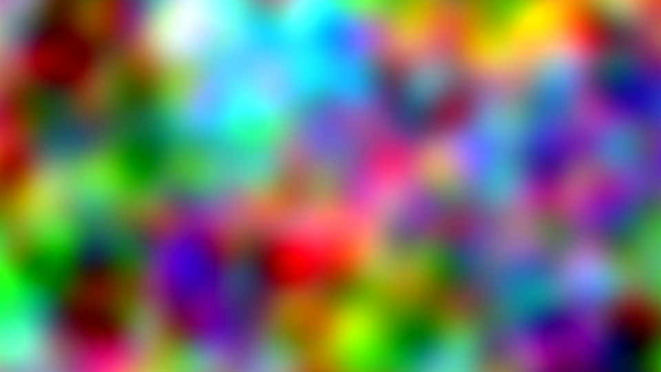
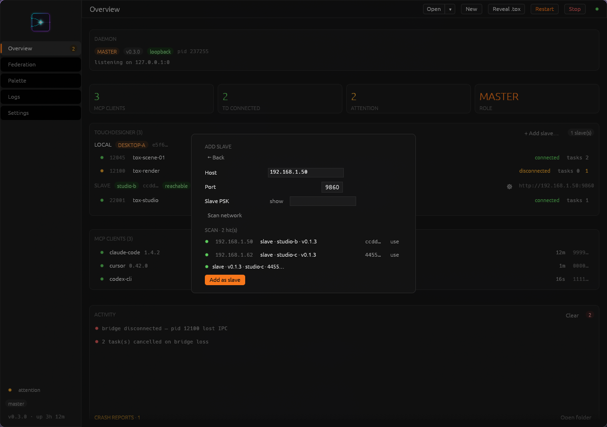
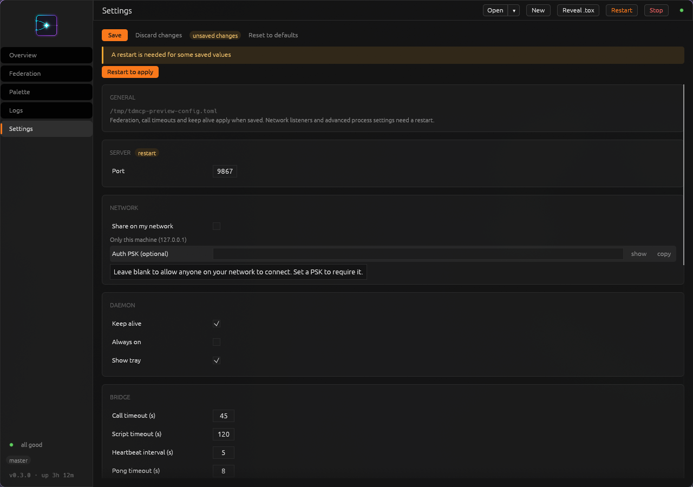
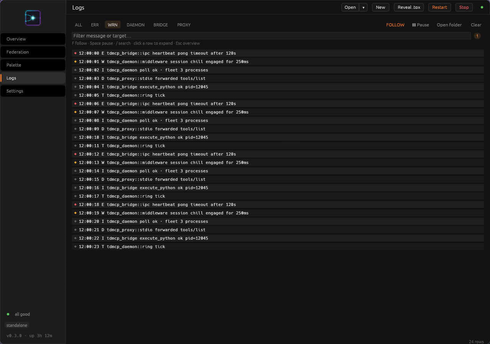

# A look around td-mcp-rs

These captures show the dashboard and two small networks built in a disposable
TouchDesigner project on October 29, 2026. **TD outputs are real MCP captures.**
Dashboard screenshots use the real application renderer with example data;
they do not establish a live multi-machine connection.

## Build a first visual


The [quick-start](QUICKSTART.md#5-make-something-small) network: three TOPs,
with the Level's brightness linked to a custom control on the parent COMP.
This version uses coloured noise at 960×540.



Captured from `/project1/first_visual/out1`. The texture is an example result;
its colours and pattern depend on the noise settings and sampling time.

## Timed capture and recording


A short GLSL shader drives these ribbons from timeline time. The assistant
created the network through MCP, then captured its TOP output. The
[shader source](screens/captures-2026-10-29/ribbons.frag) is included.

The timed capture advanced every intervening frame and returned these samples:

| Sample offset | Project frame | Capture |
| --- | --- | --- |
| 0 | 1 |  |
| 30 | 31 |  |
| 60 | 61 |  |

These samples used a prepared, paused timeline at 60 fps, without reset or
warmup. This demonstrates scheduled observation of an animated shader; it is
not evidence of a feedback reset or real-time throughput. Each paired output
inspection reported no errors or warnings.

[Watch or download the two-second recording](screens/captures-2026-10-29/ribbons-recording.mp4).
The recording continues from project frame 61 through 180. The original was
qtrle MOV; the linked H.264 MP4 is a smaller presentation copy. Both decoded
to 120 frames, 1280×720, at 60 fps. First, middle, and last decoded MP4 frames
were visually reviewed. There is no audio.

Try your own version with the [timing recipes](RECIPES.md#look-at-specific-frames).

## See your instances and assistants


The Overview groups TD processes by computer and shows connected assistants.
This preview deliberately includes connected and disconnected rows. All names,
addresses, counters, and activity here are fixture data. `127.0.0.1:0` in the
preview is not an address to configure; the normal HTTP port is 9860.

## Reuse a component


The Palette screen brings together the catalogue, descriptions, and reuse
actions. These example cards illustrate the interface; they are not a fresh
scan or proof of a particular component's behavior on your TD build.
See [Palette recipes](RECIPES.md#teach-it-your-palette).

## Connect another computer



“Add slave” is the dashboard's label for adding a joined computer. The
preview contains example discovery results and an empty key field. Follow
[Federation](FEDERATION.md) for an actual connection; a saved entry still
needs to be verified in Overview.

## Change settings and investigate problems



The restart notice distinguishes saved configuration from running settings.
This is a preview; its configuration path and port are examples.
See [Configuration](CONFIG.md).



The Logs view helps locate a failed call or connection problem. These are
synthetic preview records; their timeout values are not configuration defaults.
See [Logs and troubleshooting](OBSERVABILITY.md).

## Capture details

- Live output: TouchDesigner 2025.32460 under Wine/Linux, task-owned PID 218150.
  The instance was closed after capture; that PID is historical, not a target
  to use now. No existing user project was edited.
- UI previews: `tdmcp-gui` v0.3.0, built from revision `30a8142` with the
  `preview` feature. Screenshots are 1280×900, captured from the native window
  on Hyprland. The network screenshot is a 1600×340 region of the scratch
  TD window, excluding the surrounding desktop and application chrome.
- Capture PNGs are the original MCP image payloads, including the timed
  samples. UI screenshots were captured directly with `grim`; no interface
  labels or connection states were edited into an image.
- [Capture metadata](screens/captures-2026-10-29/capture-metadata.json) and
  [record metadata](screens/captures-2026-10-29/record-metadata.json) preserve
  the successful requests/results. Job IDs are historical and were released
  or invalidated when the scratch process closed.
- An initial timed attempt stopped on detected transport interference before
  collecting a sample. The root timeline was then explicitly paused with
  realtime disabled; the subsequent job completed. Only the completed job's
  images are published here.
- [Asset manifest](screens/captures-2026-10-29/manifest.json) lists dimensions,
  byte counts, and SHA-256 hashes. The 146 MB source MOV remains outside the
  repository; the MP4 keeps the published assets small.

### Recreate the examples

Use a new scratch project with a connected bridge and discover its current
PID. For the first visual, follow the quick-start chain, turn off the Noise
TOP's monochrome setting, set period to 2 and resolution to 960×540, and link
Level `brightness1` to the COMP's `Brightness` control. The captured example
used `absTime.seconds * 0.15` for the Noise TOP's Z translation.

For the ribbons, put the supplied shader text in a Text DAT and select it as
a GLSL TOP's pixel shader. Set resolution to 1280×720; name the first vector
uniform `uMotion`, with X expression `me.time.seconds`. Wire a Null TOP after
it. Prepare the scratch timeline paused at frame 1, with realtime off and at
least 180 frames available. Capture offsets `[0, 30, 60]` with `after: pause`,
then record 120 frames. Poll to completion and retrieve the artifact before
closing TD. The shader has no accumulated state to reset.

For dashboard previews:

```sh
cargo build --locked -p tdmcp-gui --features preview --example dashboard_preview
TDMCP_PREVIEW_SCENE=overview-populated target/debug/examples/dashboard_preview
```

Other scenes used here are `palette-tree`, `logs-filtered`, `settings-dirty`,
and `modal-add-slave`. On the capture host, `WINIT_X11_SCALE_FACTOR=1` kept
preview text at its normal size. Capture only the preview window, move the
pointer away to avoid tooltips, and label its data as an example. The existing
[screenshot helper](../scripts/capture_previews.sh) supports macOS captures.
